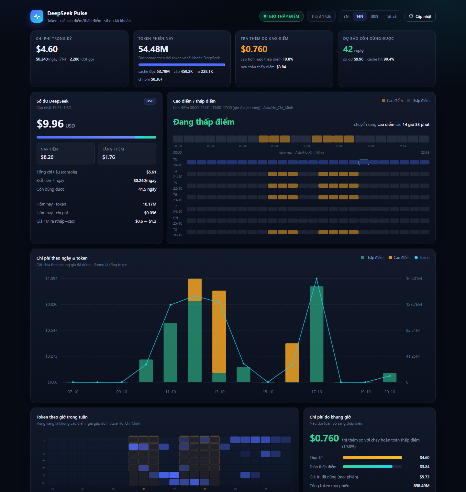
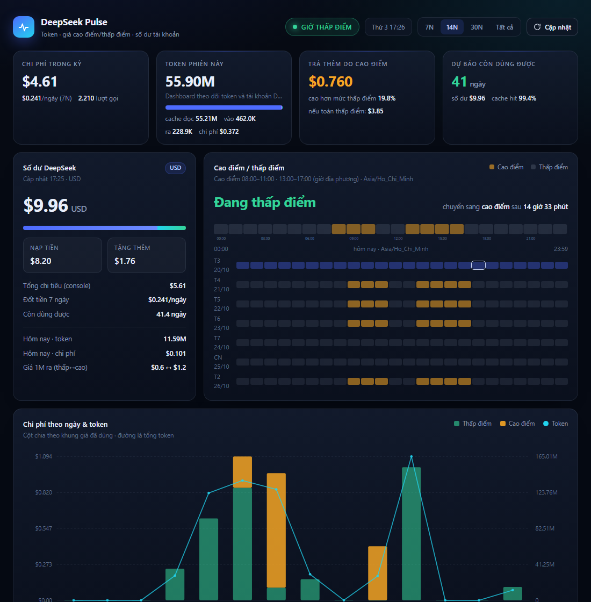

# DeepSeek Pulse

Dashboard cho tài khoản DeepSeek của bạn, trả lời ba câu hỏi:

1. **Đã dùng bao nhiêu token, lúc nào?** — token theo ngày, theo giờ trong tuần, theo phiên.
2. **Bao nhiêu phần chi phí rơi vào giờ cao điểm?** — đồng hồ cao điểm/thấp điểm có đếm ngược, timeline 24 giờ, lưới 7 ngày, và số tiền "trả thêm" do chạy trong khung giá gấp đôi.
3. **Tài khoản còn bao nhiêu tiền, dùng được bao lâu nữa?** — số dư thật lấy từ DeepSeek Platform (nạp tiền + tặng thêm), tốc độ đốt tiền 7 ngày, dự báo số ngày còn lại.

Có hai cách dùng, cùng một mã nguồn:

| Cách | Giao diện | Khi nào dùng |
| --- | --- | --- |
| **Plugin DeepSeek Harness** | Panel **Pulse** trong sidebar của app, kèm cảnh báo cao điểm | Dùng hằng ngày — không thêm cổng, không thêm tiến trình |
| **Server độc lập** | `http://127.0.0.1:4577` | Khi không mở Harness, hoặc để nhúng ở nơi khác |

Không cần API key, không cần đăng nhập lại: dashboard đọc phiên đăng nhập DeepSeek mà **DeepSeek Harness đã lưu sẵn** trên máy.

## Cài đặt trên máy khác

> Hướng dẫn đầy đủ từng bước: **[INSTALL.md](INSTALL.md)** (tiếng Việt, có xử lý sự cố).

**Cách nhanh nhất** — cài như plugin Harness, trong một phiên agent:

```
plugin_manager  action=install_bundle  target=github:mitokm/deepseek-pulse
```

Sau đó **thoát hẳn và mở lại Harness**, rồi `Ctrl+R` để nạp giao diện. Kết quả: mục **Pulse** ở sidebar + dock nhỏ ở góc trái dưới.

**Hoặc chạy độc lập** (không cần Harness, chỉ cần Node ≥ 24):

```bash
git clone https://github.com/mitokm/deepseek-pulse.git
cd deepseek-pulse
node server.mjs        # mở http://127.0.0.1:4577
```



## Dùng như plugin (đã cài sẵn cho profile `desktop`)

Kiểm tra trong **Settings → Plugins** (mục `deepseek-pulse`), hoặc bằng `plugin_manager list_plugins`.

Sau khi cài lần đầu — hoặc sau khi sửa client half — **tải lại cửa sổ Harness một lần** (`Ctrl+R`) để nạp module client.

Plugin gồm hai nửa:

- **Host half** (`lib/plugin-host.mjs`) mount dashboard tại `/pulse` trên chính web server của Harness — dùng lại `public/` và `lib/` của server độc lập, nên chỉ có một bản UI.
- **Client half** (`lib/client.cjs`) đăng ký ba chỗ:
  - `main` (key `pulse`): panel nhúng dashboard (cùng origin, không cần cổng riêng);
  - `sidebar.panellist`: icon **Pulse** để mở panel;
  - `shell.overlay`: cảnh báo cao điểm luôn chạy, kể cả khi không mở panel.



> Gói được pnpm **copy** vào profile, không symlink. Sau khi sửa code trong repo, đồng bộ lại rồi `Ctrl+R`:
>
> ```powershell
> Copy-Item .\lib\* "$env:USERPROFILE\.dsh\profiles\desktop\node_modules\deepseek-pulse\lib\" -Recurse -Force
> Copy-Item .\public\* "$env:USERPROFILE\.dsh\profiles\desktop\node_modules\deepseek-pulse\public\" -Recurse -Force
> ```
>
> Thay đổi ở host half chỉ có hiệu lực sau khi khởi động lại Harness (module đã nạp vào bộ nhớ).

Cấu hình plugin nằm ở lớp patch của profile — `~/.dsh/profiles/desktop/cordis.patch.yml`:

```yaml
- id: deepseek-pulse
  config:
    peakWarningMinutes: 15          # cảnh báo trước bao nhiêu phút
    displayTimeZone: Asia/Ho_Chi_Minh
    defaultRangeDays: 14
    # sessionDir: C:\Users\<you>\.dsh\sessions   # tùy chọn
```

Gỡ cài đặt: `plugin_manager remove_bundle` với `deepseek-pulse`, hoặc tắt trong Settings → Plugins.

### Cài từ GitHub

```powershell
# trong agent của Harness
plugin_manager  action=install_bundle  target=github:<user>/deepseek-pulse
```

hoặc bằng pnpm trong profile:

```powershell
cd "$env:USERPROFILE\.dsh\profiles\desktop"
pnpm add "github:<user>/deepseek-pulse"
```

rồi thêm `deepseek-pulse` vào `dsh.profile.bundles` trong `package.json` của profile và khởi động lại Harness.

## Dock ở góc trái dưới

Ngoài panel đầy đủ, plugin gắn một **thẻ nhỏ luôn hiển thị** ở góc trái dưới cửa sổ (trên thanh Settings), tận dụng khoảng trống cuối sidebar:

```
● THẤP ĐIỂM
cao điểm 08:00 · còn 14 giờ 38 phút
──────────────────────────
Phiên này              48.95M
Hôm nay                $0.070
Số dư                  $10.04
```

- Bấm vào thẻ → mở panel Pulse đầy đủ.
- Nút `–` thu gọn thành một viên nhỏ (chỉ còn chấm trạng thái + token phiên); trạng thái nhớ trong `localStorage`.
- Tự ẩn khi sidebar thu gọn (rail), vì lúc đó không còn chỗ.
- Dữ liệu: `/pulse/api/peak` mỗi 30 giây, `/pulse/api/overview?days=1` mỗi 60 giây.

## Cảnh báo khi số dư giảm

Mỗi khi số dư tụt đủ **một mức** (mặc định **$1.00**, chỉnh được từ **$0.10**), dashboard bắn một thông báo desktop:

```
Số dư giảm $1.02
Còn $10.04 · ngưỡng báo $1.00
```

Đổi mức ngay trong thẻ **Số dư DeepSeek** → ô *"Báo khi số dư giảm"* (nhập số, tối thiểu 0.10). Một ngưỡng dùng chung cho **cả hai kênh**:

- **thông báo desktop** (panel + dock, lấy từ `/api/alerts`);
- **email** — host kiểm tra mỗi `checkMinutes` và gửi qua SMTP.

Giá trị được ghi vào `~/.dsh/pulse-alert.json` (`dropAmount`) nên email và desktop luôn cùng ngưỡng; `localStorage` chỉ giữ bản sao để dock báo ngay trước khi host đọc lại file.

Cách hoạt động:

- Mẫu số dư được so với **mốc** đã lưu; chênh lệch ≥ mức báo thì thông báo và dời mốc. Giảm lẻ tẻ (0.3 + 0.3 + 0.5) cộng dồn tới mức mới báo, tránh spam.
- Nạp thêm tiền (số dư tăng) → tự dời mốc, im lặng.
- Nút **Thử thông báo** để kiểm tra quyền và cách hiển thị.
- Dock hiện thêm dòng `−$1.02 · còn $10.04` trong 20 giây sau mỗi lần báo.

Cấu hình email nằm ở `~/.dsh/pulse-alert.json` (mẫu: `pulse-alert.example.json`): `to`, `smtp.host/port/user/pass`, `checkMinutes`. Trạng thái (mốc + lần gửi cuối) ở `~/.dsh/pulse-alert-state.json`.

Lưu ý:

- Thông báo desktop chạy khi cửa sổ Harness (hoặc tab dashboard) đang mở — số dư lấy mỗi 60 giây.
- Cần quyền `Notification`; nếu chưa cấp, nút *Thử thông báo* sẽ báo "trình duyệt chưa cho phép".
- Đổi ngưỡng từ dashboard cần host đã nạp bản có `POST /api/alerts/config`; bản host cũ vẫn nhận giá trị qua `localStorage` nhưng email giữ ngưỡng trong file. Khởi động lại Harness một lần sau khi cập nhật.

## Cảnh báo cao điểm

Overlay kiểm tra mỗi 30 giây. Khi sắp bước vào khung giá gấp đôi (mặc định trước **15 phút**):

- hiện **thẻ cảnh báo** ở góc dưới phải cửa sổ Harness;
- bắn **thông báo desktop** (`Notification` của Electron/trình duyệt) kèm giờ bắt đầu cao điểm.

Thẻ có hai nút: **Đã hiểu** (im tới lần chuyển khung kế tiếp) và **Tắt 1 giờ**. Mốc tắt lưu trong `localStorage`.

Nếu chưa cấp quyền thông báo, chỉ thẻ trong app hiện ra — bấm biểu tượng ổ khoá trên thanh địa chỉ để cấp quyền.

## Cảnh báo số dư qua email

Ngoài cảnh báo cao điểm, Pulse có thể gửi **email** mỗi khi số dư DeepSeek giảm đủ một ngưỡng — mặc định **$1**, và **chỉ một email cho mỗi lần giảm** (không lặp lại ở các vòng kiểm tra sau).

Tạo `~/.dsh/pulse-alert.json` (xem mẫu `pulse-alert.example.json`):

```json
{
  "enabled": true,
  "to": "ban@example.com",
  "from": "ban@gmail.com",
  "dropAmount": 1,
  "checkMinutes": 5,
  "smtp": {
    "host": "smtp.gmail.com",
    "port": 465,
    "secure": true,
    "user": "ban@gmail.com",
    "pass": "mat-khau-ung-dung"
  }
}
```

| Khóa | Ý nghĩa |
| --- | --- |
| `enabled` | Bật/tắt cảnh báo |
| `to` | Email nhận cảnh báo |
| `from` | Địa chỉ gửi (mặc định bằng `smtp.user`) |
| `dropAmount` | Ngưỡng giảm, USD (mặc định `1`) |
| `checkMinutes` | Bao lâu kiểm tra số dư một lần (mặc định `5`, tối thiểu `1`) |
| `smtp.host` / `port` / `secure` | Máy chủ SMTP: `465` + `secure: true` (TLS ngầm) hoặc `587` + `secure: false` (STARTTLS) |
| `smtp.user` / `pass` | Tài khoản gửi. Gmail cần **mật khẩu ứng dụng** 16 ký tự (bật 2FA → App passwords), không phải mật khẩu đăng nhập |

Máy chủ thường dùng: **Gmail** `smtp.gmail.com:465` · **Yahoo** `smtp.mail.yahoo.com:465` · **Outlook** `smtp-mail.outlook.com:587` (`secure: false`). Cả Gmail và Yahoo đều yêu cầu *app password* (Yahoo: Account Security → bật 2-step verification → Generate app password), không nhận mật khẩu đăng nhập thường.

Cách hoạt động:

- Lần chạy đầu lấy số dư hiện tại làm **mốc** và chưa gửi gì.
- Khi số dư giảm ≥ `dropAmount` so với mốc: gửi **một** email, rồi đặt mốc bằng số dư mới → mỗi $1 chỉ một email.
- Nạp tiền: mốc tự nâng lên, không gửi cảnh báo.
- Mốc và lần gửi gần nhất lưu ở `~/.dsh/pulse-alert-state.json`, nên khởi động lại Harness không gửi lại email cũ.
- Chỉ chạy khi Harness đang mở; mật khẩu không bị ghi ra log.

Gửi thử ngay (không cần khởi động lại Harness):

```powershell
node tools/test-alert.mjs --dry-run   # xem cấu hình đã đọc đúng chưa
node tools/test-alert.mjs             # gửi một email thử
```

Kiểm tra trạng thái: `GET /pulse/api/alerts`. Kích hoạt kiểm tra ngay: `POST /pulse/api/alerts/check`.

## Thẻ "Token phiên này"

Thẻ KPI thứ hai hiển thị **phiên đang làm việc** (token, cache đọc/vào/ra, chi phí) thay cho tổng theo kỳ — tổng kỳ vẫn nằm trong tooltip của thẻ.

- Server trả `currentSession`: phiên có hoạt động mới nhất (hoặc phiên chỉ định qua `?session=<id>`).
- Trước khi plugin host nạp bản mới, UI tự lấy dòng đầu bảng phiên làm phương án dự phòng (đúng số tổng và chi phí, chưa có thanh chia cache/vào/ra).

## Chạy độc lập

```powershell
cd deepseek-pulse
node server.mjs          # hoặc nhấp đôi start.cmd
```

Mở **http://127.0.0.1:4577**. Yêu cầu Node.js ≥ 24 (cần `zlib.zstdDecompressSync`); `start.cmd` tự dùng Node đi kèm DSH nếu Node trên PATH cũ hơn.

## Dữ liệu lấy từ đâu

| Số liệu | Nguồn | Ghi chú |
| --- | --- | --- |
| Số dư, tổng chi tiêu | `GET https://platform.deepseek.com/api/v0/users/get_user_summary` | Gửi kèm grant trong `~/.dsh/.credentials.yaml` (`deepseek-account-platform/default`) |
| Token theo phiên | `~/.dsh/sessions/**/session.v4.jsonl.zstd` | Mỗi `assistant/message` có `usage` thật do API trả về; file là chuỗi nhiều frame zstd nên dashboard tự tách frame |
| Giá, khung giờ | `config.json` | Chép từ [Models & Pricing](https://api-docs.deepseek.com/quick_start/pricing) |

Chi phí là **ước tính** theo bảng giá công bố; số dư và "tổng chi tiêu" là số liệu thật từ Platform.

## Cách tính khung giá

Theo [tài liệu giá DeepSeek](https://api-docs.deepseek.com/quick_start/pricing):

- **Cao điểm**: 01:00–04:00 và 06:00–10:00 UTC, thứ Hai–thứ Sáu, **trừ ngày lễ Trung Quốc**.
- **Thấp điểm**: mọi thời điểm còn lại (kể cả cuối tuần và ngày lễ), giá bằng **một nửa** giá cao điểm.

Với `Asia/Ho_Chi_Minh` (UTC+7): **08:00–11:00** và **13:00–17:00** các ngày trong tuần.

| Model | Cache hit (thấp ↔ cao) | Cache miss (thấp ↔ cao) | Output (thấp ↔ cao) |
| --- | --- | --- | --- |
| `deepseek-flash` | 0.003 ↔ 0.006 | 0.15 ↔ 0.30 | 0.60 ↔ 1.20 |
| `deepseek-v4-pro` | 0.022 ↔ 0.044 | 0.66 ↔ 1.32 | 1.98 ↔ 3.96 |

USD / 1M token. Công thức: `(cacheRead × hit + (input + cacheWrite) × miss + output × out) / 1.000.000`.
"Nếu toàn thấp điểm" = tính lại toàn bộ token ở giá thấp điểm; chênh lệch là khoản trả thêm do giờ cao điểm.

## Cấu hình (`config.json`)

| Khóa | Ý nghĩa |
| --- | --- |
| `port`, `host` | Mặc định `4577`, chỉ nghe `127.0.0.1`. Override bằng biến môi trường `PORT`. |
| `displayTimeZone` | Múi giờ hiển thị (mặc định `Asia/Ho_Chi_Minh`). |
| `peakWarningMinutes` | Cảnh báo trước bao nhiêu phút khi sắp vào cao điểm. |
| `peakSchedule.windowsUTC` | Các khung cao điểm theo UTC. |
| `peakSchedule.holidaysCST` | Ngày lễ Trung Quốc không tính cao điểm. Danh sách 2026 theo [thông báo Quốc vụ viện](https://www.gov.cn/zhengce/content/202511/content_7047090.htm); sang năm cần cập nhật. |
| `pricing.perMillion` | Bảng giá theo model; `modelAliases` gộp tên cũ (`deepseek-chat`, `deepseek-v4-flash`, …). |

## Quyền riêng tư

- Token đăng nhập chỉ được đọc từ đĩa và gửi tới `platform.deepseek.com` — không trả về trình duyệt, không ghi log.
- Route `/pulse` không hỏi đăng nhập (giống các route phụ khác của Harness) và chỉ phục vụ trên `127.0.0.1`. Đừng mở Harness ra mạng ngoài nếu không muốn chia sẻ số dư.
- Server độc lập cũng chỉ nghe `127.0.0.1`.

## Hạn chế đã biết

- Chỉ thấy usage **phát sinh qua DeepSeek Harness**. Gọi API từ công cụ khác (curl, SDK riêng, web chat) không hiện ở đây — chỉ hiện gián tiếp qua số dư giảm.
- "Tổng chi tiêu (console)" có thể gồm cả giao dịch CNY nên không cộng thẳng với chi phí ước tính.
- Chi phí ước tính lệch vài phần trăm so với hoá đơn thật (bảng giá đổi, cách quy đổi cache write).
- Ngày lễ 2026 hard-code; năm sau cần bổ sung.
- Thông báo desktop cần quyền `Notification`; nếu bị chặn, vẫn còn thẻ cảnh báo trong app.

## Xử lý sự cố

| Hiện tượng | Cách xử lý |
| --- | --- |
| Không thấy icon Pulse | Tải lại cửa sổ Harness (`Ctrl+R`); kiểm tra Settings → Plugins có `deepseek-pulse` và đang bật. |
| Panel trống | Mở thẳng `http://127.0.0.1:19387/pulse/` xem dashboard có lỗi không; xem console của cửa sổ Harness. |
| Card số dư báo "Chưa tìm thấy phiên đăng nhập" | Đăng nhập DeepSeek trong Harness rồi bấm **Cập nhật**. |
| Báo "Phiên đăng nhập đã hết hiệu lực" | Đăng xuất/đăng nhập lại trong DSH. |
| Bảng trống, 0 phiên | Kiểm tra `%USERPROFILE%\.dsh\sessions`; hoặc đặt `DSH_HOME` nếu DSH dùng thư mục khác. |
| Lỗi `zstd` khi chạy độc lập | Dùng Node ≥ 24 (`start.cmd`). |
| Có thẻ trong app nhưng **không có toast Windows** | Windows đang tắt thông báo. Kiểm tra `HKCU\Software\Microsoft\Windows\CurrentVersion\PushNotifications\ToastEnabled` = 1 (Settings → System → Notifications), và tắt Focus Assist (`Win+N`). Sau khi bật, mở lại app để Windows đăng ký nó vào danh sách app được thông báo. |

## Công cụ dev

`tools/preview.mjs` render bằng Chrome headless qua CDP, chụp ảnh và báo cáo tràn layout + lỗi console:

```powershell
node tools/preview.mjs 1440 2400 docs/preview.png
```

Ảnh trong `docs/` được chụp qua `tools/demo-page.html` — trang này lấy dữ liệu thật nhưng **thay số dư, chi phí console và tên phiên bằng giá trị mẫu**, nên ảnh công khai không lộ tài khoản:

```powershell
Copy-Item .\tools\demo-page.html .\public\_demo.html
$env:PULSE_URL = "http://127.0.0.1:4577/_demo.html"
$env:CLIP = "0,0,1440,1520"; node tools/preview.mjs 1440 900 docs/screenshot.png
$env:CLIP = "0,0,1100,1120"; node tools/preview.mjs 1100 900 docs/panel.png
Remove-Item .\public\_demo.html
```

`tools/` không nằm trong gói plugin (`files` chỉ gồm `lib`, `public`, `config.json`, `cordis.patch.yml`).
